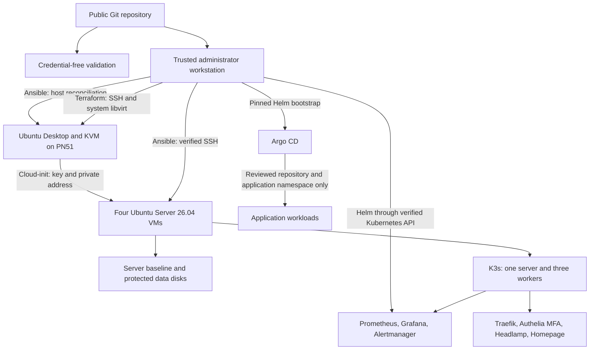
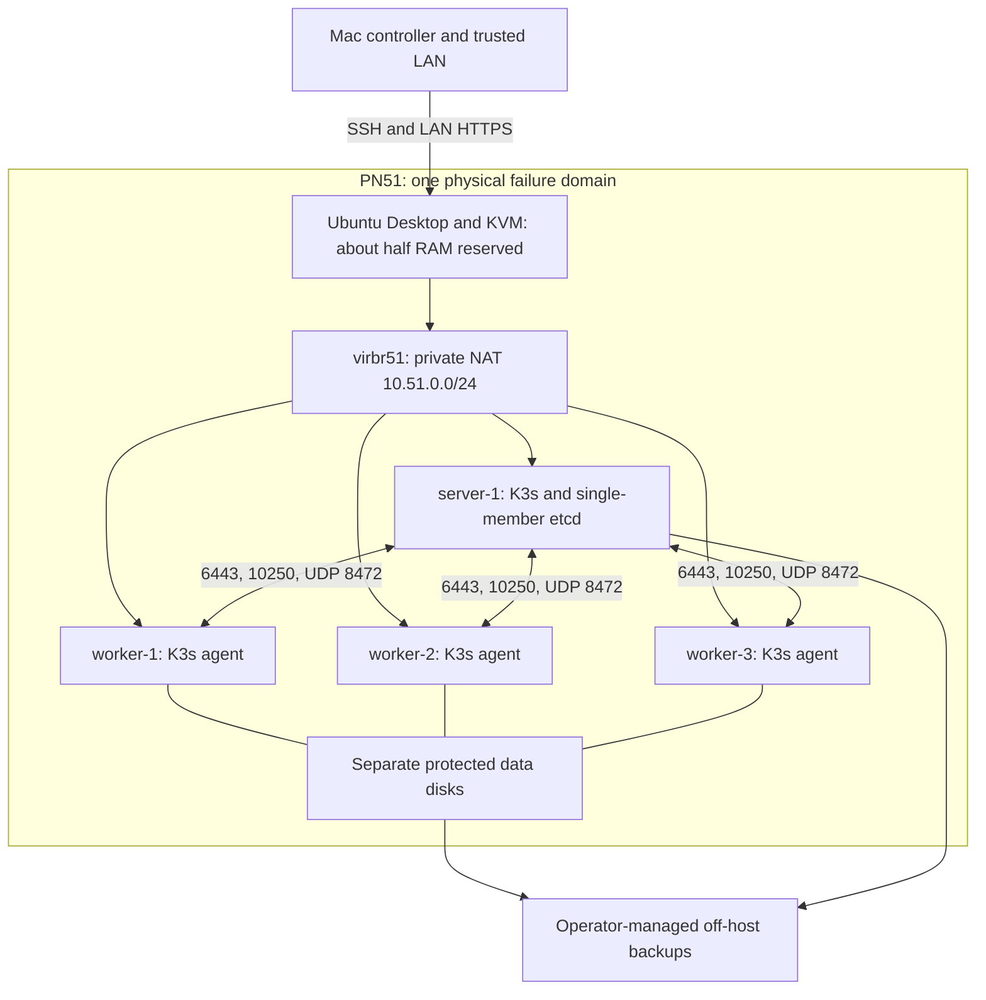

# Architecture and Decisions

## Ownership

GitHub Actions validates source and scans Git history. It cannot reach the
homelab and receives no SSH key, vault password, or kubeconfig.
The separate documentation publisher only writes the documentation branch.

Terraform owns VM identity, CPU, RAM, replaceable root disks, protected data
disks, the NAT network, addresses, and imported image. Cloud-init owns the initial `ubuntu`
account and authorized public keys. Ansible waits for cloud-init to finish, then
owns the Ubuntu host, guest baseline/firewall, K3s, monitoring, platform, and
Argo CD bootstrap. Argo CD owns only explicitly admitted application workloads;
its default project is locked and it does not adopt Ansible-managed resources.
Legacy retirement is a separately guarded cold-backup and ingress cutover.

The private Ansible inventory comes from Terraform output. CIDRs and the cluster
DNS address travel through that inventory rather than being duplicated in group
variables. Helm release credentials are not stored in Terraform state.

## Physical and Logical Topology

All node pairs also exchange VXLAN and kubelet traffic where required. The
diagram abbreviates those links. No etcd ports or NodePort range are exposed
between VMs: this is not a multi-server etcd cluster, and applications are not
published directly. The dedicated host proxy forwards LAN 80/443 to Traefik;
Authelia protects the dashboard routes, while the API uses the SSH tunnel.

## Why These Choices

| Decision | Reason | Cost |
| --- | --- | --- |
| Native Ubuntu KVM/libvirt | Keeps the existing Desktop host and automates VM lifecycle | Host libvirt access is privileged |
| Server guests | Smaller memory, disk, and attack surface; Desktop is only a host requirement | No guest graphical desktop |
| Cloud image, cloud-init, Ansible | Checksummed base and repeatable bootstrap without interactive installers | First boot needs package/DNS access |
| K3s rather than kubeadm | Bundled runtime, CNI, storage bootstrap, and lower operational overhead | K3s-specific configuration and upgrade procedures |
| One server and three workers | Leaves three workload nodes and a simple recovery model | API outage on server restart; no control-plane HA |
| Embedded etcd | Native scheduled snapshots and a documented restore path | One member is not redundant storage |
| Scoped nftables input firewall | Default-deny guest ingress without flushing CNI state | Forwarding and pod isolation need their own controls |
| Protected data disks and retained local-path storage | Root replacement preserves application files | Node affinity remains; not replicated or protected against NVMe failure |
| Traefik and Authelia | HTTPS plus default-deny MFA for dashboards | Internal CA trust and enrollment remain explicit |
| Read-only Headlamp | Inspect Kubernetes with short-lived tokens | Mutating administrator UI access is not granted by default |
| Vault and existing SSH keys | No credential generation or Kubernetes authentication in Terraform | Vault password and backups remain operator responsibilities |

Three control-plane VMs on this same host would tolerate a guest failure, but not
a PN51 power, network, or disk failure. For useful HA, add independent physical
hosts and storage before increasing control-plane count.

## Reconciliation and Recovery

Normal configuration runs do not perform unconditional package upgrades, reboot
nodes, rotate credentials, or restart SSH/K3s. Templates and checksums notify
handlers only when their inputs change. Workers are updated serially and drained
before K3s changes; disruption budgets are respected.

Worker replacement is intentionally separate from reconciliation. Its helper
checks node-local volumes, checks the remaining nodes, validates the complete
Terraform plan, and asks for an exact typed confirmation. Control-plane
replacement requires [snapshot recovery](../operations.md#how-to-recover-the-control-plane).

The design is declarative at its ownership boundaries, not a promise that state
can be thrown away. Preserve the Terraform state, vault, original server token,
etcd snapshots, and application backups outside the PN51.

See [the input reference](../reference.md) and [security boundaries](../security.md).
