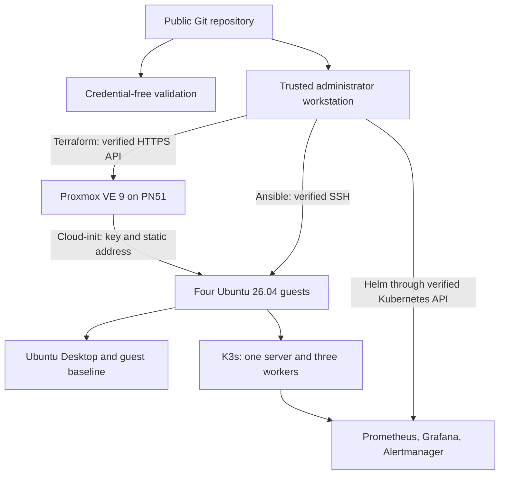
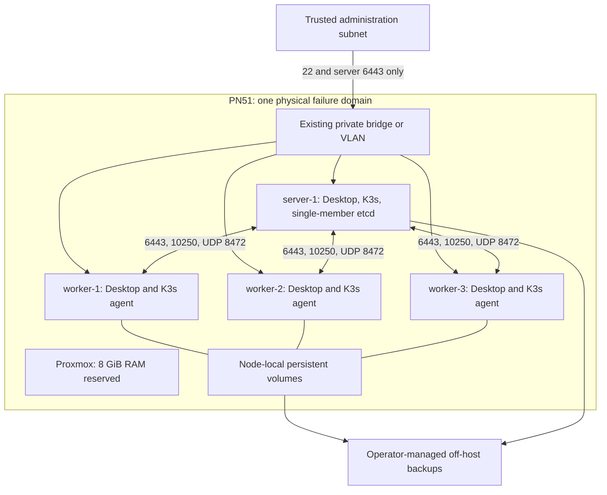

# Architecture and Decisions

## Ownership

GitHub Actions validates source and scans Git history. It cannot reach the
homelab and receives no Proxmox token, SSH key, vault password, or kubeconfig.
The separate documentation publisher only writes the documentation branch.

Terraform owns VM identity, CPU, RAM, disks, virtual displays, static addressing,
the imported image, and VM firewall rules. Cloud-init owns the initial `ubuntu`
account and authorized public keys. Ansible waits for cloud-init to finish, then
owns the desktop, guest baseline, K3s service, and monitoring release.

The private Ansible inventory comes from Terraform output. CIDRs and the cluster
DNS address travel through that inventory rather than being duplicated in group
variables. Helm release credentials are not stored in Terraform state.

## Physical and Logical Topology

All node pairs also exchange VXLAN and kubelet traffic where required. The
diagram abbreviates those links. No etcd ports or NodePort range are exposed
between VMs: this is not a multi-server etcd cluster, and applications are not
published by default.

## Why These Choices

| Decision | Reason | Cost |
| --- | --- | --- |
| Proxmox rather than nested local virtualization | Dedicated VM lifecycle, bridge networking, console, backups, API imports | One manual, potentially destructive host installation |
| Full Desktop on all VMs | Meets the desktop requirement with inspectable virtual consoles | Larger memory, disk, update, and attack-surface budget than Server |
| Cloud image plus Ansible | Checksummed base and repeatable package state without interactive installers | First desktop installation needs network access and time |
| K3s rather than kubeadm | Bundled runtime, CNI, storage bootstrap, and lower operational overhead | K3s-specific configuration and upgrade procedures |
| One server and three workers | Leaves three workload nodes and a simple recovery model | API outage on server restart; no control-plane HA |
| Embedded etcd | Native scheduled snapshots and a documented restore path | One member is not redundant storage |
| Proxmox VM firewall | Filters outside guest container networking | Requires the datacenter firewall enabled and verified |
| Local-path storage | Small footprint and no pretend redundancy on one NVMe disk | A data-bearing VM cannot be replaced without data work |
| Vault and existing SSH keys | No credential generation or Kubernetes authentication in Terraform | Vault password and backups remain operator responsibilities |

Three control-plane VMs on this same host would tolerate a guest failure, but not
a PN51 power, network, or disk failure. For useful HA, add independent physical
hosts and storage before increasing control-plane count.

## Reconciliation and Recovery

Normal configuration runs do not perform unconditional package upgrades, reboot
nodes, rotate credentials, or restart SSH/K3s. Templates and checksums notify
handlers only when their inputs change. Workers are updated serially and drained
before K3s changes; disruption budgets are respected.

Worker replacement is intentionally separate from reconciliation. Its helper
checks node-local volumes, checks the remaining nodes, validates the complete
Terraform plan, and asks for an exact typed confirmation. Control-plane
replacement requires [snapshot recovery](../operations.md#how-to-recover-the-control-plane).

The design is declarative at its ownership boundaries, not a promise that state
can be thrown away. Preserve the Terraform state, vault, original server token,
etcd snapshots, and application backups outside the PN51.

See [the input reference](../reference.md) and [security boundaries](../security.md).
